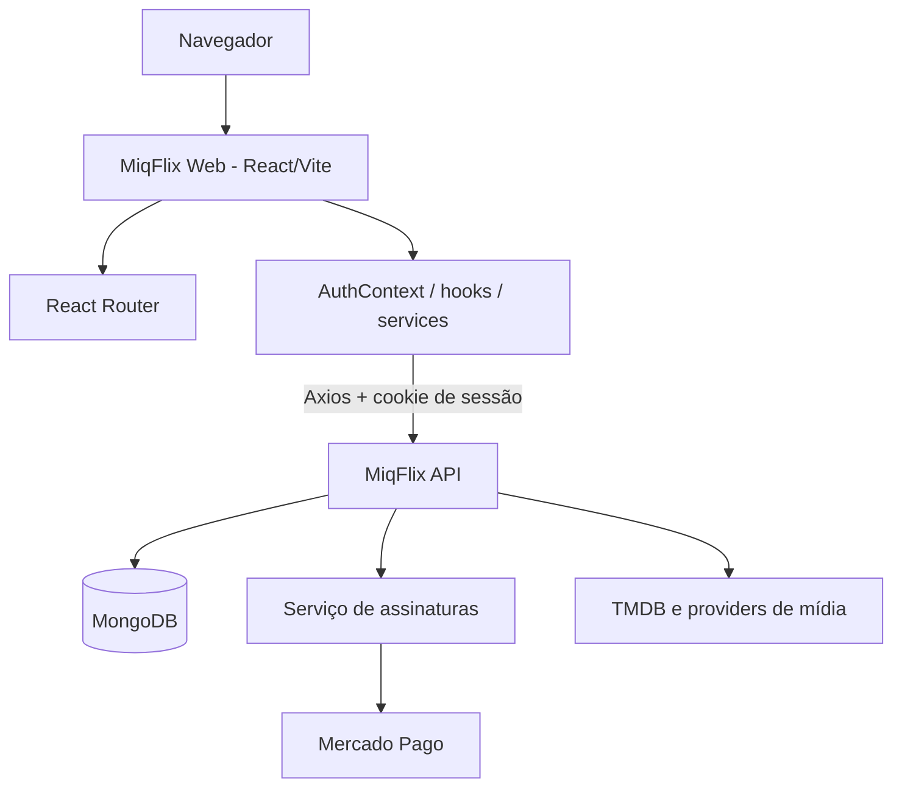
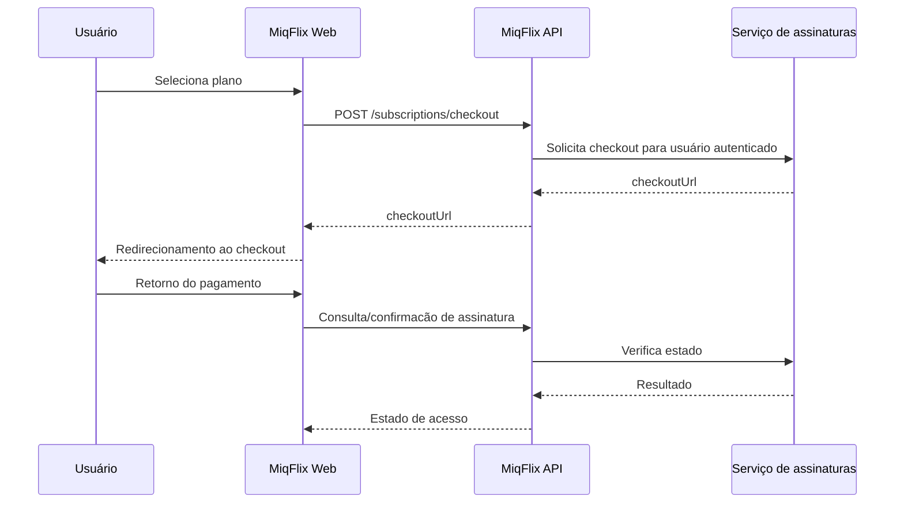

# MiqFlix Web

> Interface web do MiqFlix para descoberta de filmes e séries, autenticação, favoritos, reprodução, progresso de episódios e contratação de planos.

**Repositório:** `barbie-movies` · **Aplicação:** React + Vite · **Idioma da interface:** Português

## Sumário

- [Sobre o projeto](#sobre-o-projeto)
- [Funcionalidades](#funcionalidades)
- [Stack](#stack)
- [Arquitetura e integração](#arquitetura-e-integração)
- [Estrutura de diretórios](#estrutura-de-diretórios)
- [Pré-requisitos](#pré-requisitos)
- [Instalação](#instalação)
- [Configuração de ambiente](#configuração-de-ambiente)
- [Comandos disponíveis](#comandos-disponíveis)
- [Rotas da aplicação](#rotas-da-aplicação)
- [Autenticação e assinatura](#autenticação-e-assinatura)
- [Reprodução e progresso](#reprodução-e-progresso)
- [Integração com a API](#integração-com-a-api)
- [Deploy na Vercel](#deploy-na-vercel)
- [Boas práticas e limitações](#boas-práticas-e-limitações)
- [Roadmap](#roadmap)

## Sobre o projeto

O **MiqFlix Web** é a interface de navegação e reprodução do ecossistema MiqFlix. A aplicação consome uma API REST própria para consultar o catálogo, autenticar usuários, recuperar favoritos e progresso de reprodução e iniciar o fluxo de assinaturas.

O frontend **não se conecta diretamente ao MongoDB nem ao Mercado Pago com credenciais privadas**. Essas responsabilidades ficam nos serviços de backend.

## Funcionalidades

### Catálogo e descoberta

- Página inicial com destaques e listagens de filmes.
- Catálogo de séries e visualização de detalhes.
- Busca e navegação pelo conteúdo.
- Exibição de informações e imagens do catálogo.

### Conta e personalização

- Cadastro e login.
- Recuperação da sessão autenticada.
- Logout.
- Filmes e séries favoritos.
- Progresso de reprodução de séries.

### Reprodução

- Página de reprodução de filmes.
- Player de episódios de séries.
- Mecanismos de recuperação de falhas em streaming HTML5.
- Integração com diferentes fontes de vídeo, conforme suporte da API e do player.

### Assinaturas

- Consulta de planos.
- Página de assinatura.
- Início de checkout por meio da API.
- Retorno de pagamento e consulta do acesso do usuário.
- Rotas de reprodução condicionadas ao estado de assinatura.

### Administração (estado do código analisado)

O frontend ainda contém páginas administrativas de filmes e séries (`/admin` e `/admin/series`). A migração dessas funcionalidades para **MiqFlix Admin**, em `admin.miqflix.site`, é uma evolução planejada, não uma remoção já concluída.

## Stack

| Categoria | Tecnologia |
| --- | --- |
| Interface | React 19 |
| Bundler | Vite 8 |
| Navegação | React Router 7 |
| HTTP | Axios |
| Ícones | Lucide React |
| Busca com debounce | `use-debounce` |
| Qualidade | ESLint |
| Hospedagem prevista | Vercel |

O código analisado utiliza JavaScript/JSX e CSS, sem configuração TypeScript.

## Arquitetura e integração



**Responsabilidades:**

- **Frontend:** apresentação, navegação, estado de interface e interação com o usuário.
- **API principal:** autenticação, autorização, catálogo, favoritos, progresso e intermediação de assinaturas.
- **Serviço de assinaturas:** planos, checkout, pagamentos e validade do acesso.

## Estrutura de diretórios

```text
barbie-movies/
├── public/                       # Arquivos estáticos e ícones
├── src/
│   ├── assets/                   # Imagens e recursos visuais
│   ├── components/
│   │   ├── series-details/       # Componentes de detalhes e player de séries
│   │   ├── ProtectedRoute.jsx
│   │   ├── SubscriptionRoute.jsx
│   │   ├── Layout.jsx
│   │   ├── Navbar.jsx
│   │   └── ...
│   ├── config/
│   │   ├── api.js
│   │   └── genres.js
│   ├── contexts/
│   │   ├── AuthContext.jsx
│   │   └── SearchContext.jsx
│   ├── hooks/
│   │   ├── useWatchProgress.js
│   │   ├── useStreamRecovery.js
│   │   ├── useSeriesDetails.js
│   │   └── useSeriesFavorite.js
│   ├── pages/
│   │   ├── Home.jsx
│   │   ├── Player.jsx
│   │   ├── SeriesCatalog.jsx
│   │   ├── SeriesDetails.jsx
│   │   ├── Favorites.jsx
│   │   ├── AuthPage.jsx
│   │   ├── SubscriptionPage.jsx
│   │   ├── CheckoutReturn.jsx
│   │   ├── Admin.jsx
│   │   └── SeriesManager.jsx
│   ├── services/
│   │   ├── api.js
│   │   ├── movies.js
│   │   ├── series.js
│   │   ├── tmdb.js
│   │   └── watchProgress.js
│   ├── App.jsx                    # Definição das rotas
│   └── main.jsx                   # Ponto de entrada React
├── eslint.config.js
├── index.html
├── package.json
├── vite.config.js
└── vercel.json                    # Rewrites da aplicação
```

## Pré-requisitos

- Node.js compatível com Vite 8 e npm.
- Instância acessível da **MiqFlix API**.
- Serviço de assinaturas configurado no backend para testar pagamentos.
- Navegador moderno.

Para requisitos específicos de versão do Node.js, consulte o `engines` das dependências instaladas e a documentação da versão do Vite utilizada.

## Instalação

```bash
git clone <URL_DO_REPOSITORIO_BARBIE_MOVIES>
cd barbie-movies
npm ci
```

### Configuração de ambiente

Crie `.env` na raiz:

```dotenv
# Opção A: API via proxy/rewrite local e em produção
VITE_API_URL=/api
```

O código em `src/services/api.js` usa `/api` como fallback, mas alguns componentes também consultam `import.meta.env.VITE_API_URL` diretamente. **Defina explicitamente `VITE_API_URL`** para manter comportamento consistente.

Se o frontend chamar a API diretamente, use uma URL base que inclua o prefixo `/api`:

```dotenv
# Opção B: chamada direta à API
VITE_API_URL=http://localhost:3001/api
```

Na opção B, o backend deve permitir a origem do frontend no CORS. Para autenticação por cookies, valide também os atributos do cookie e o contexto de domínio.

**Nunca inclua segredos em variáveis `VITE_*`:** tudo o que começa com `VITE_` pode ser incorporado ao bundle público do navegador.

### Desenvolvimento local com proxy

Se escolher `VITE_API_URL=/api`, configure um proxy no `vite.config.js` para encaminhar as chamadas ao backend local, caso ainda não exista:

```javascript
import { defineConfig } from "vite";
import react from "@vitejs/plugin-react";

export default defineConfig({
  plugins: [react()],
  server: {
    proxy: {
      "/api": {
        target: "http://localhost:3001",
        changeOrigin: true,
      },
    },
  },
});
```

Este bloco é uma **configuração sugerida**, não uma afirmação de que o proxy já existe no repositório.

## Comandos disponíveis

```bash
npm run dev      # Servidor de desenvolvimento
npm run build    # Build de produção
npm run preview  # Pré-visualização do build
npm run lint     # Verificação ESLint
```

O `npm run dev` utiliza `vite --host`. A porta usual do Vite é `5173`, salvo alteração por configuração ou indisponibilidade.

## Rotas da aplicação

Rotas identificadas em `src/App.jsx`:

| Caminho | Página | Proteção |
| --- | --- | --- |
| `/` | Home | Pública |
| `/login` | Login | Pública |
| `/register` | Cadastro | Pública |
| `/subscription` | Planos/assinatura | Pública |
| `/series` | Catálogo de séries | Pública |
| `/checkout/retorno` | Retorno de checkout | Login |
| `/favorites` | Favoritos | Login |
| `/movie/:id` | Reprodução de filme | Login + assinatura |
| `/series/:id` | Detalhes/reprodução de série | Login + assinatura |
| `/admin` | Administração de filmes | Admin |
| `/admin/series` | Administração de séries | Admin |
| `*` | Página não encontrada | Pública |

A proteção de rotas no React é apenas uma camada de experiência do usuário. **O backend deve validar autenticação, permissões e assinatura em cada operação protegida.**

## Autenticação e assinatura

O `AuthContext`:

1. Consulta `/auth/me` ao iniciar a aplicação.
2. Mantém `user` e `loading` no estado.
3. Disponibiliza `login`, `register`, `logout` e `refreshUser`.
4. Compartilha a sessão entre componentes por meio de contexto.

O cliente Axios em `src/services/api.js` utiliza:

```javascript
const api = axios.create({
  baseURL: import.meta.env.VITE_API_URL || "/api",
  withCredentials: true,
  timeout: 15000,
  headers: {
    "Content-Type": "application/json",
  },
});
```

O backend usa cookie de sessão `HttpOnly`; o frontend não deve ler nem armazenar o JWT em `localStorage`.

### Fluxo de assinatura



O frontend **não calcula nem autoriza o preço final**; essa responsabilidade é do serviço de assinaturas.

## Reprodução e progresso

Os componentes centrais são:

- `src/pages/Player.jsx`: reprodução de filmes.
- `src/pages/SeriesDetails.jsx`: detalhes e seleção de episódios.
- `src/components/series-details/SeriesPlayer.jsx`: reprodução de episódios.
- `src/hooks/useStreamRecovery.js`: recuperação de falhas de streaming.
- `src/hooks/useWatchProgress.js`: gerenciamento do progresso.
- `src/services/watchProgress.js`: comunicação com a API de progresso.

### Atenção: fontes do YouTube

No snapshot analisado, `SeriesDetails.jsx` monta uma URL `/stream?page=...` para o `videoUrl` do episódio, e `SeriesPlayer.jsx` usa `<video>`. **URLs de páginas do YouTube não são arquivos MP4 e não podem ser reproduzidas diretamente em `<video>`.**

A integração correta exige identificação da origem e renderização de um iframe oficial para vídeos incorporáveis. Essa correção foi discutida separadamente e **não está incluída no ZIP original usado como base desta documentação**.

A YouTube IFrame Player API será necessária caso se deseje rastrear progresso e eventos de reprodução com a mesma precisão de um elemento HTML5.

## Integração com a API

O módulo `src/services/api.js` concentra autenticação e assinaturas. Serviços específicos organizam chamadas de filmes, séries, TMDB e progresso.

### Principais endpoints consumidos

| Recurso | API |
| --- | --- |
| Sessão | `/api/auth/me` |
| Login | `/api/auth/login` |
| Cadastro | `/api/auth/register` |
| Logout | `/api/auth/logout` |
| Filmes | `/api/movies` |
| Séries | `/api/series` |
| Favoritos | `/api/movies/favorites/list`, `/api/series/favorites/list` |
| Planos | `/api/subscriptions/plans` |
| Acesso | `/api/subscriptions/access` |
| Checkout | `/api/subscriptions/checkout` |
| Confirmação | `/api/subscriptions/confirm` |
| Streaming | `/api/stream` |

### Tratamento de erros

O interceptor Axios:

- Define timeout de 15 segundos.
- Exibe diagnósticos em ambiente de desenvolvimento.
- Detecta quando a API retorna HTML em vez de JSON.
- Diferencia falha de rede, timeout e erros HTTP.
- Evita registrar como erro inesperado a ausência normal de sessão na consulta inicial.

## Deploy na Vercel

O repositório contém `vercel.json` com:

1. Rewrite de `/api/:path*` para uma API publicada na Railway.
2. Fallback de rotas SPA para `/index.html`.

### Procedimento

1. Importe o repositório na Vercel.
2. Configure o framework como **Vite**.
3. Defina o build command `npm run build`.
4. Utilize `dist` como diretório de saída.
5. Configure `VITE_API_URL=/api` se utilizar o rewrite.
6. Revise o destino do rewrite em `vercel.json`.
7. Faça deploy e teste login, catálogo, player e assinatura.

**Importante:** o `vercel.json` do ZIP contém uma URL específica de Railway. Revise-a antes de reutilizar em outro ambiente; ela não é um destino universal.

### Domínio

A aplicação de streaming pode ser publicada em `www.miqflix.site`. O projeto **MiqFlix Admin** está planejado para `admin.miqflix.site`, como frontend separado, com autenticação e autorização administrativas no backend.

## Boas práticas e limitações

- **Autorização:** não confie apenas em `ProtectedRoute` ou `SubscriptionRoute`; revalide no servidor.
- **Segredos:** não exponha chaves de pagamentos, JWT, banco ou integração interna no bundle.
- **Cookies e CORS:** confirme funcionamento em HTTPS e no domínio definitivo.
- **Streaming:** diferencie URLs de mídia de páginas de plataformas; verifique codecs e suporte de incorporação.
- **Progresso:** teste mudanças de episódio, retomada, falhas de rede e fontes incorporadas.
- **Acessibilidade:** mantenha navegação por teclado, estados de carregamento e mensagens de erro compreensíveis.
- **Conteúdo:** publique ou incorpore apenas material cuja distribuição seja autorizada.
- **Testes:** o `package.json` analisado não contém comando `test`; recomenda-se adicionar testes de componentes e integração.
- **Build:** execute `npm run lint` e `npm run build` antes de publicar.

## Roadmap

Itens propostos, **não necessariamente implementados**:

- [ ] Migrar administração para o projeto independente MiqFlix Admin.
- [ ] Consolidar seleção de player por provider (HTML5, YouTube, HLS).
- [ ] Integrar YouTube IFrame Player API ao progresso de episódios.
- [ ] Adicionar testes automatizados de rotas e componentes.
- [ ] Melhorar observabilidade e métricas de reprodução.
- [ ] Documentar contratos HTTP com OpenAPI no backend.
- [ ] Revisar acessibilidade e comportamento em dispositivos móveis.

## Projetos relacionados

- **MiqFlix API:** backend Node.js/Express (`movies-api`).
- **Serviço de assinaturas:** cobrança, planos e integração Mercado Pago.
- **MiqFlix Admin:** painel administrativo independente (em desenvolvimento).

---

**MiqFlix Web** — documentação técnica baseada na estrutura do repositório analisado.
